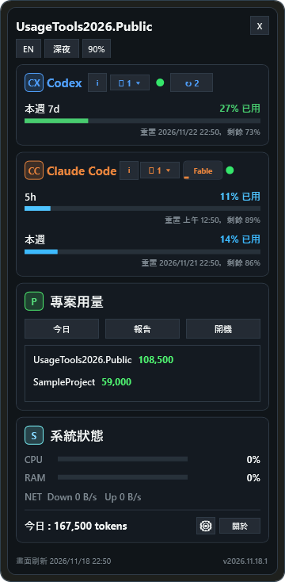

# UsageTools2026.Public

Windows 桌面用量工具，可查看 Codex 與 Claude Code 的額度、重置時間、專案 Token 和系統狀態。支援簡易模式、HTML 報告及自架手機看板。

**EricsWei** 開發者 · **Atu** 專案參與人員



## 建置與執行

需要 Windows、.NET 10 SDK 和 WebView2 Runtime。

```powershell
dotnet restore UsageTools2026.csproj --locked-mode
dotnet build UsageTools2026.csproj -c Debug --no-restore -p:ApplicationManifest=app.review.manifest
.\bin\Debug\net10.0-windows\UsageTools2026.exe
```

上述預覽版以一般權限執行。正式版以 `-c Release` 建置，使用要求管理員權限的預設 manifest。

程式讀取目前 Windows 使用者的用量紀錄與登入狀態。設定存於 `%LOCALAPPDATA%\UsageTools2026.Public`。用量查詢仰賴各家的非公開介面，可能隨服務更新而變動。

## 手機同步與自動更新

兩項服務預設未設定。桌面版可獨立使用。

<details>
<summary>自架設定</summary>

**手機同步**　把 [Mobile](Mobile) 部署到自己的 HTTPS／PHP 主機，填寫 [PersonalMobileService.cs](Services/PersonalMobileService.cs) 的 `BaseUrl` 和 `TeamBaseUrl` 後重新建置。

多人模式的 `Mobile/server-config.php` 由 `<?php exit; ?>` 一行接 JSON。可先使用 `{"mode":"multi","registrationEnabled":false,"maxAccounts":100,"maxRegistrationsPerHour":10}`。開放註冊前，核對 HTTPS、Authorization 轉發、帳號隔離、限流與資料檔存取限制。每位使用者各自配對，通知記錄可用 [清理工具](tools/mobile/cleanup-history.php) 維護。

**自動更新**　在 [UpdateConfiguration.cs](Services/UpdateConfiguration.cs) 設定自己的 HTTPS feed 與 RSA 驗章公鑰。[簽章工具](tools/update) 使用的私鑰須留在倉庫與公開目錄之外。保留下載驗證及更新回復流程。

</details>

<details>
<summary>更新器建置與自測</summary>

- 更新器使用 `dotnet build Updater/UsageToolsUpdater.csproj -c Release` 建置。
- 桌面程式可用 `--parse-selftest`、`--mobile-selftest`、`--health-selftest`、`--stage-b-selftest` 執行合成資料測試。
- 手機頁面可執行 `npm install --prefix Mobile`，再使用已安裝的 Chrome 跑 `node Mobile/test-claude-details.cjs Reports/ClaudeUI`。PHP 契約測試使用 `php -n Mobile/test-claude-contract.php`。

</details>

## 授權

原始碼採 [PolyForm Noncommercial License 1.0.0](LICENSE)。可依授權在非商用範圍使用、修改和再散布。再散布時請附上授權條文或官方連結，以及 [作者聲明](NOTICE) 與適用的 [第三方聲明](THIRD_PARTY_MOBILE_NOTICES.txt)。商業用途請另向 EricsWei 取得授權。

[驗證紀錄](VERIFICATION.txt) · [檔案校驗](SHA256SUMS.txt)
